

# Plantilla Taller

**A white-label web platform for high-end auto repair shops: a cinematic public portal, a private area for owners and a shop-floor panel, wired to the shop's own ERP.**

-ffca28?logo=firebase&logoColor=black)

[What it is](#what-it-is) · [Screenshots](#screenshots) · [How it works](#how-it-works) · [Quality](#quality-and-honest-limits) · [Access](#want-to-try-it)

---

> **This is a showcase repository: write-up and screenshots only, not the source code.**
> The template is a commercial product, so the code stays private. Every customer, plate, phone number and
> amount shown is **fictional demo data**.

## What it is

Workshops that service supercars and luxury cars sell trust: the owner wants to know what is happening to the car
without calling. Plantilla Taller gives a shop three connected views and a configurator that adapts the whole thing
to the shop's brands, colour and services in seconds.

- **Public portal.** A closed garage shutter that opens as you scroll, a same-car "before and after" scene through
  four stages (reception, mechanics, bodywork and detailing, ready), and a **plate lookup** that shows a public
  status timeline. A 3-step funnel books appointments on a **green/red availability calendar**.
- **My Garage (owners).** Private area with the full intervention history, the vehicle health traffic light
  (brakes, tyres, fluids, body) and a **digital green light**: when the mechanic finds extra work, the owner approves
  or postpones it from the phone, with a signature.
- **Mechanic panel (shop floor).** One-click phase advance, per-task timers with a profitability bar
  (real time versus billable time), quick notes, pause / block with reason, hand-over notes between shifts, QR
  reception labels, WhatsApp status messages, a day-by-day logbook, a vehicle history per plate and a quote calculator.
- **ERP connector without an API.** Imports the flat files that local ERPs export (CSV, Excel, XML), proposes the
  column mapping, categorises each line by service and merges customers and history.
- **One template, many shops.** Presets for luxury and supercar specialists, multi-brand quick service, classic
  restoration and detailing; six switchable programs; brands, accent colour and narrative mode.

## Screenshots

Captured from the real app with demo data.

### Garage shutter entrance
The page opens on a closed industrial shutter that lifts with the scroll.

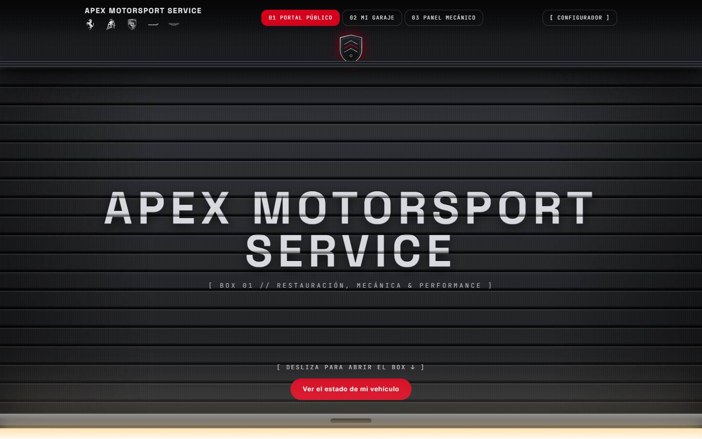

### The same car, four stages
A single sticky scene moves from the damaged car with inspection markers to the finished one.

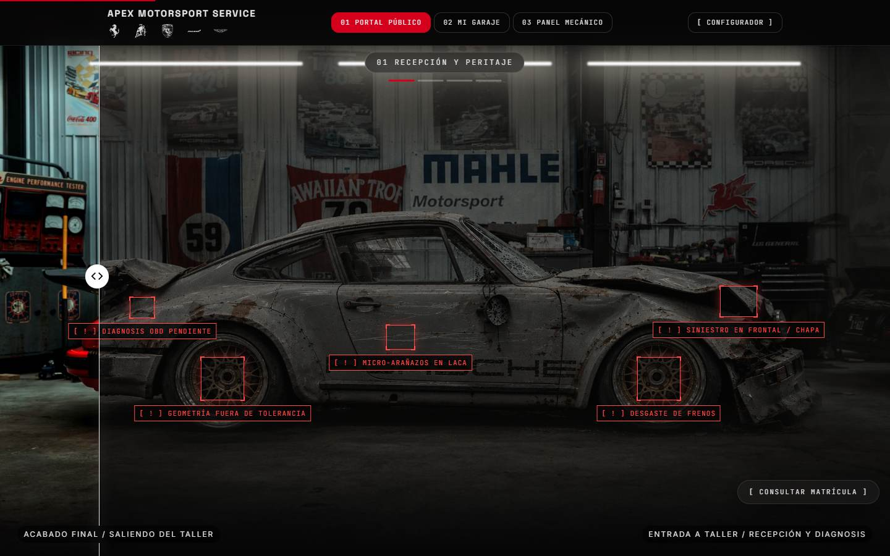

### Public plate lookup
A visitor sees the public timeline only. Private data (phone, diagnosis, internal notes, amounts) never reaches
the public view.

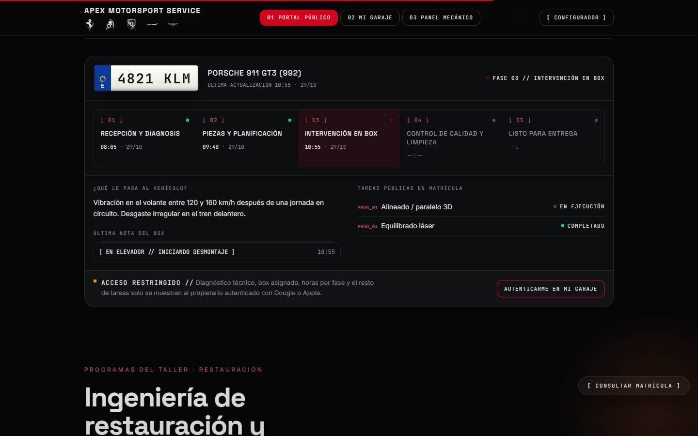

### My Garage and the digital green light
The owner approves extra work from the phone; the signed approval becomes a task for the mechanic.

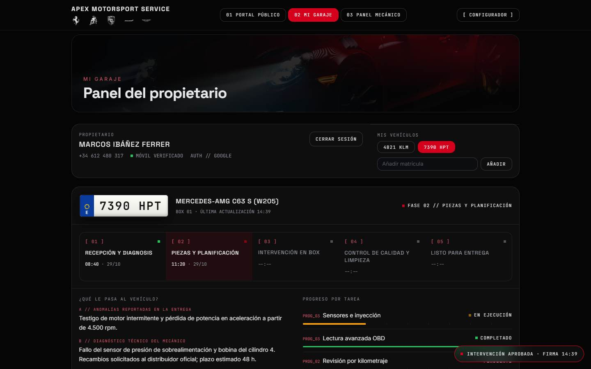

### Mechanic panel
Work orders, blocked jobs with reason, hand-over notes, one-click phase advance and timers.

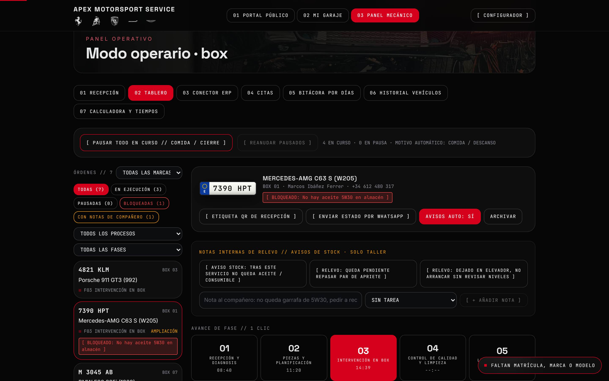

### QR reception label
A printable card with the plate, bay and a QR that opens the public status.

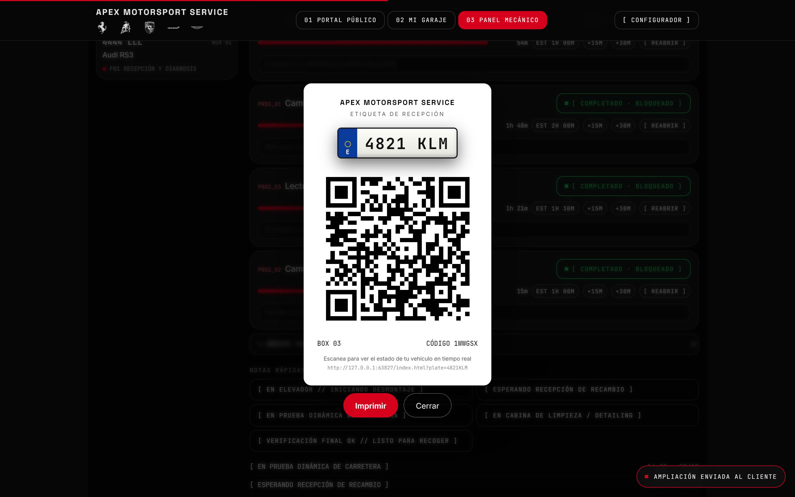

### Booking calendar
Green days are bookable, red are full or blocked, grey are closed. A plate is mandatory.

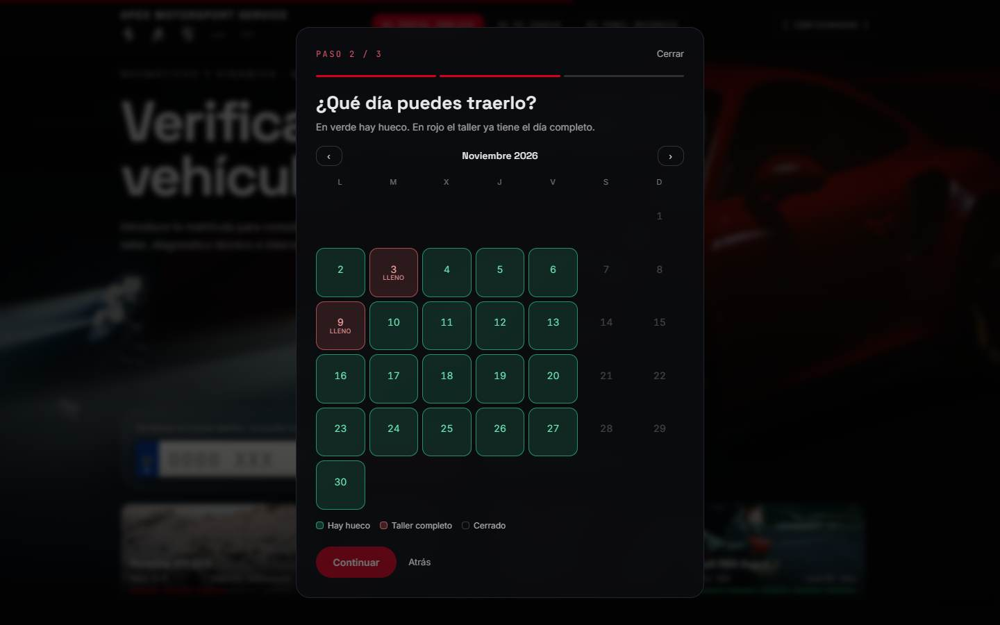

### ERP connector
Column mapping proposed automatically for a SQLPYME-style export; also Sage, SAP, XML and Excel.

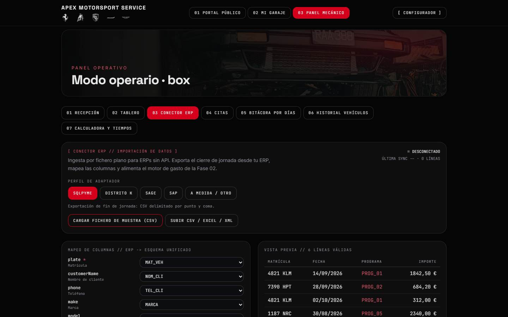

### Vehicle history and quote calculator
Every closed order is archived per plate; the calculator builds a quote and the WhatsApp text.

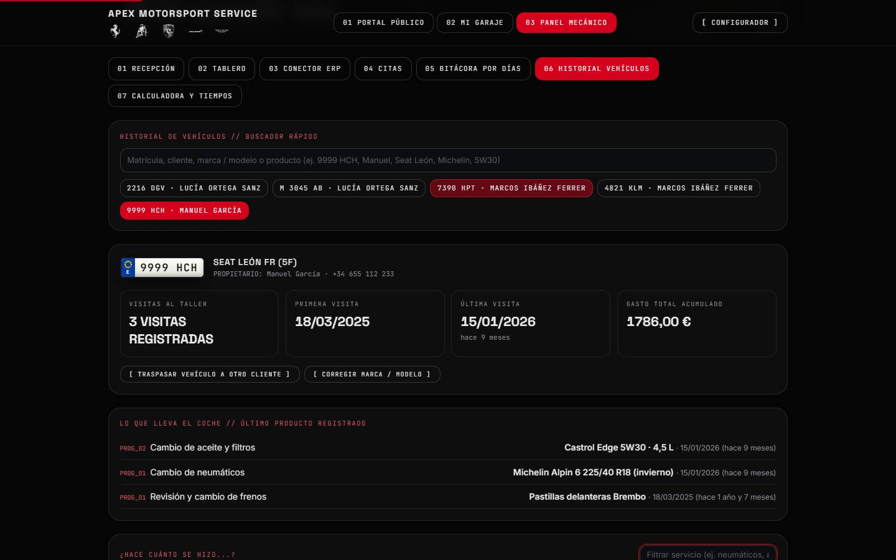
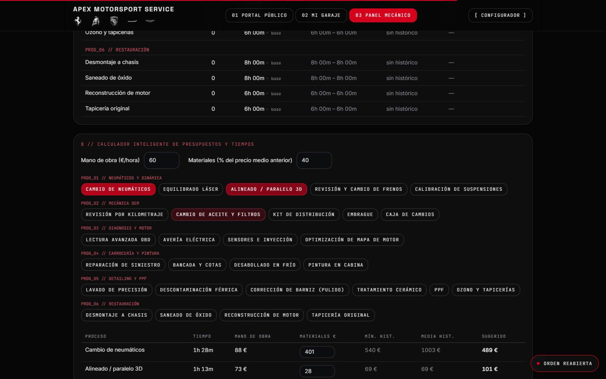

### Shop-floor operations
Pause and resume tasks without losing minutes, and a general pause for lunch or closing time.

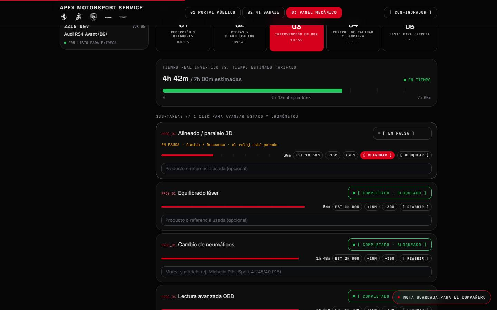

### Mobile
The public lookup on a phone.

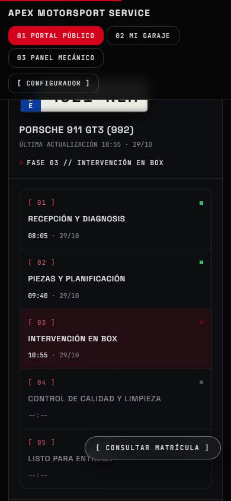

## How it works

| | |
|---|---|
| **Front end** | A single-page React app (no build step in the demo) with Tailwind; bundled third-party libraries pinned to fixed versions with integrity hashes. Works without internet for everything that is code. |
| **Data layer** | Swappable: browser storage for the demo, or Firebase (Firestore + Auth) for a real shop. |
| **Privacy by design** | The public lookup reads a separate **public mirror** of each order with only public fields. Owner approvals are decided server-side, and Firestore security rules keep private data out of reach. |
| **Booking** | Atomic slot reservation (no double booking) with closed days and a booking window enforced in the rules. |
| **WhatsApp** | Manual button today; an opt-in automatic notice (Cloud Function) is written and unit-tested but not deployed. |
| **ERP** | Flat-file import with column mapping, categorisation by service and customer merge. |

## Quality and honest limits

- **250 unit tests pass** (ERP connector, WhatsApp function, privacy mirror, ownership, history, shop operations,
  booking). A browser end-to-end suite in real Chrome (153 cases, desktop and mobile) and 23 Firestore rules tests
  against the official emulator are documented in the project's QA report.
- The tests were written and run by an AI assistant under Sothe's direction. **It is not an independent audit.**
- **Not tested:** a real Firebase project and the real WhatsApp Business API. Those need a live account and are
  the next step before a pilot with a real shop.

## Who built it

A two-person project: **Sothe** ([@ImSothe](https://github.com/ImSothe)) **leads it and specifies the product**, and it is
developed together with **TenM** ([@TenMM2](https://github.com/TenMM2)). It is built with AI assistants (Claude Code):
Sothe designs, specifies and tests, and the code is written with Claude Code.

## Want to try it?

The source code is closed. If you run or advise a workshop and want a walkthrough, or you are a recruiter,
reach out on Instagram **[@SoySothe](https://www.instagram.com/soysothe)** or on
**[LinkedIn](https://www.linkedin.com/in/%C3%A1ngel-baz-monteiro-8196a21a9/)**.

## Legal notice

© 2026 Sothe and TenM. All rights reserved. This repository contains documentation and images only; the application is
not open source and is not licensed for use or redistribution (see [LICENSE](LICENSE)). All shops, customers,
plates and amounts are fictional. Car brand names and logos appear only to show which brands a shop can
configure; they belong to their owners, and this project is independent and not affiliated with any of them.
Demo photographs come from Unsplash.
